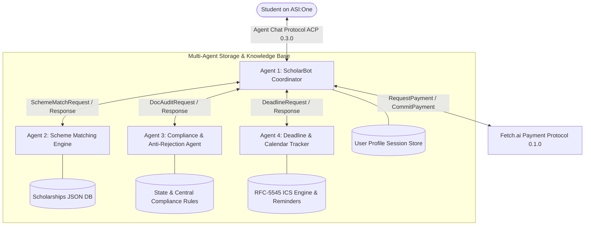

# ScholarBot: Autonomous Multi-Agent Scholarship Finder & Anti-Rejection Advisory


> **Fetch-A-Thon 3.0 Hackathon Submission**  
> *Track: ASI:One Agent Challenge – From Intent to Action (Fetch.ai Innovation Lab)*  
> An autonomous, 4-agent system that helps Indian students discover central, state, and foundation scholarships, prevents application rejection through deterministic document compliance checks, tracks dynamic deadlines with downloadable and copyable calendar alarms, and offers a Concierge Application Pack powered by the official **Fetch.ai Payment Protocol**.

---

## 🎯 Problem Statement & Real-World Impact

* **The Problem:** Over 40 million higher education students in India struggle with educational funding. Financial aid schemes are scattered across National Scholarship Portal (NSP), state portals (e.g. Rajasthan SJMS, UP Dashmottar, MahaDBT), and private trusts (Tata, Reliance, HDFC). Worse, **over 40% of eligible applications are rejected** simply due to missing NPCI Aadhaar bank seeding, expired income certificates (such as Rajasthan's strict 6-month validity rule), or mismatched names between documents and portal records.
* **Target Users:** Underprivileged Indian undergraduate, diploma, and school students (General, OBC, SC, ST, EWS, Minority) with low household income seeking legitimate financial assistance.
* **The Outcome:** The user receives a personalized list of matched scholarships, exact deadlines with calendar events, and an anti-rejection document pre-check — entirely within the **ASI:One chat interface with zero custom frontend required**.

---

## 🧠 Multi-Agent Architecture & Protocol Design

ScholarBot is built using **4 specialized autonomous uAgents** collaborating over native Fetch.ai protocols:



### 🌐 Registered Agent Addresses & Persistent Identity

Agent addresses are derived cryptographically from each agent's persistent seed. To view your persistent agent addresses, run:

```bash
python scripts/print_addresses.py
```

| Agent | Role | Seed Variable | Persistent Address |
|-------|------|---------------|-------------------|
| **ScholarBot Coordinator** | Primary Chat & Payment Interface | `COORDINATOR_SEED` | `agent1q... [Run scripts/print_addresses.py]` |
| **Scheme Matching Engine** | Filtering, Scoring & State Logic | `MATCHER_SEED` | `agent1q... [Run scripts/print_addresses.py]` |
| **Doc Compliance Auditor** | Statutory Document Pre-Checks | `AUDITOR_SEED` | `agent1q... [Run scripts/print_addresses.py]` |
| **Deadline Tracker** | Deadlines, Alarms & .ICS Engine | `TRACKER_SEED` | `agent1q... [Run scripts/print_addresses.py]` |

### 1. `ScholarshipCoordinatorAgent` (Interface & Orchestrator)
- **Role:** Handles incoming chat from ASI:One via **Agent Chat Protocol (ACP 0.3.0)** (`ChatMessage`, `ChatAcknowledgement`, `MetadataContent`).
- **Function:** Runs the **ASI1 LLM Brain** for free-text profile extraction, routes intents, manages user session state in `ctx.storage`, renders **ASI:One Interactive Cards**, orchestrates specialist subagents, and handles the **Payment Protocol**.
- **Resilience:** Features built-in in-process fallbacks with automatic retry if any subagent is unreachable over the network.

### 2. `SchemeMatchingAgent` (Deterministic Fit & Eligibility Engine)
- **Port:** `8002` | **Seed:** `scholarship_matching_engine_seed_2026_xyz`
- **Function:** Evaluates academic marks (`min_marks`), family income ceilings, state domicile, social category, gender-specific criteria (AICTE Pragati, Kotak Kanya), and disability status (AICTE Saksham). Returns ranked matches along with **close-miss opportunities** (e.g. "within ₹20k of threshold").

### 3. `DocComplianceAgent` (Anti-Rejection & Verification Specialist)
- **Port:** `8003` | **Seed:** `scholarship_compliance_auditor_seed_2026_xyz`
- **Function:** Performs deterministic compliance audits on student certificates (income, caste, marksheet, bonafide):
  - Checks date validity against statutory windows (e.g., Rajasthan 6-month validity).
  - Verifies income figure against the scheme ceiling.
  - Performs fuzzy name matching between student profile and legal certificates.
  - Automatically masks sensitive numbers (Aadhaar, PAN) as `XXXX-XXXX-1234` to protect student privacy.

### 4. `DeadlineTrackerAgent` (Dynamic Cutoff & Calendar Specialist)
- **Port:** `8004` | **Seed:** `scholarship_deadline_tracker_seed_2026_xyz`
- **Function:** Computes dynamic countdowns against published cutoff dates for the 2026-27 academic session. Generates downloadable RFC-5545 `.ics` calendar events with alarms set for 7 days, 3 days, and 1 day before cutoff. Runs an hourly heartbeat via `@tracker.on_interval` to monitor approaching deadlines.

---

## 🎴 ASI:One Interactive Cards Guided UX

ScholarBot eliminates walls of plain text by using **ASI:One Interactive Cards**:

1. **Action Hub Carousel (`card_kind: "carousel"`):** 1-click access to Search, Document Audit, Deadlines, "What-If" Simulation, and Saved Profile.
2. **Intake Form Card (`card_kind: "form"`):** Dropdowns for home state (all 28 states + UTs), study program, social category, income, marks percentage, gender, and disability status.
3. **Profile Review Screen (`card_kind: "review"`):** Shows extracted student credentials with "Confirm & Find Scholarships" and "Edit Profile" actions.
4. **Scholarships Carousel (`card_kind: "carousel"`):** Horizontal scrollable cards displaying grant amount, match %, deadline badge, and action CTA.
5. **Detail Guide Card (`card_kind: "detail"`):** Summary rows, direct official portal link, and a CTA to run the Document Pre-Check.
6. **Audit Results Card (`card_kind: "review"`):** Readiness score (0-100), overall status (PASS/WARN/FAIL), itemized checklist, and actionable remedies.

---

## 💳 Fetch.ai Payment Protocol & Monetization Model

### Business Model
1. **Free for All Students:** Core scholarship discovery, eligibility matching, document rules, and deadline countdowns are **100% free**.
2. **Paid Application Concierge Pack (₹1 - ₹2 / 0.01 USDC):**
   - Implemented via the official **`AgentPaymentProtocol` (version 0.1.0)** from `uagents_core.contrib.protocols.payment`.
   - The student approves a `RequestPayment` transaction, the Coordinator verifies the `CommitPayment`, issues `CompletePayment`, and immediately delivers the Concierge Pack:
     - Pre-filled application dossier.
     - Mandatory document checklist.
     - Step-by-step portal submission workflow.
     - **Custom Statement of Purpose (SOP / Application Essay)** drafted by the ASI1 LLM.
     - Downloadable `.ics` calendar event.
3. **B2B Model (Post-Hackathon):** Bulk eligibility screening API for rural colleges, CSR foundations, and education NGOs.

---

## ⚠️ Known Limitations & Honest Disclosures

1. **Unverified Data Status:** All entries in `data/scholarships.json` currently have `verified: false` and `last_verified: null` pending manual portal-by-portal verification. ScholarBot interactive cards explicitly display `"Unverified, confirm on official portal"` on each scheme card. Never rely solely on automated discovery without confirming on the official government or foundation portal.
2. **Biometric & OTP Portal Submissions:** Government scholarship portals (National Scholarship Portal, state portals) mandate Aadhaar OTP or biometric authentication and CAPTCHA. ScholarBot assists with eligibility discovery, document compliance pre-checks, and application dossiers, but does NOT submit final applications on behalf of students. Final submission must be completed on the official portal by the student.
3. **Payment Protocol Testnet / Demo Mode:** The Fetch.ai Payment Protocol implementation operates with `PAYMENT_DEMO_MODE=true` for evaluation. Users submit `CommitPayment` with a test transaction hash, which is verified before unlocking the concierge dossier.
4. **Document Pre-Check Scope:** Document audits are rule-based pre-checks examining dates, ceilings, issuing authorities, and name similarity. An audit pass does not assure government approval, as government officials review physical and original records.
5. **Aadhaar & PII Privacy:** Full 12-digit Aadhaar numbers and PAN cards are strictly masked as `XXXX-XXXX-1234` in all logs, messages, and card payloads before processing.

---

## 🚀 Quick Start Guide

### 1. Prerequisites
- Python 3.10+ (tested on Python 3.12)
- Pip package manager

### 2. Installation
```bash
git clone https://github.com/your-username/scholarship_finder_agent.git
cd scholarship_finder_agent
pip install -r requirements.txt
```

### 3. Environment Setup
Copy the example configuration:
```bash
cp .env.example .env
```
Edit `.env` to supply:
- `ASI1_API_KEY`: Your key from [asi1.ai](https://asi1.ai) (optional; intelligent regex fallback is active).
- `AGENTVERSE_MAILBOX_KEY`: Your key from [agentverse.ai](https://agentverse.ai) for live ASI:One connectivity.

### 4. Run the Full Test Suite
Verify all 21 unit tests and end-to-end conversation flows:
```bash
python -m pytest tests/ -v
```

### 5. Run the Local Multi-Agent Verification Pipeline
```bash
python test_local.py
```

### 6. Start All 4 Agents Concurrently
Launch the unified Fetch.ai Bureau:
```bash
python run_all.py
```

---

## 🌐 Agent Addresses & Agentverse Registration

Agent addresses are derived dynamically and cryptographically from each agent's unique seed (configured via environment variables or securely generated on startup):

| Agent Name | Function | Configuration Seed | Default Port |
| :--- | :--- | :--- | :--- |
| **ScholarshipCoordinatorAgent** | ASI:One Facing, ACP 0.3.0, Cards, Payment Protocol | `COORDINATOR_SEED` | 8001 |
| **SchemeMatchingAgent** | Eligibility & Course/Marks Filtering | `MATCHER_SEED` | 8002 |
| **DocComplianceAgent** | Deterministic Document Pre-Check & Privacy Masking | `AUDITOR_SEED` | 8003 |
| **DeadlineTrackerAgent** | Cutoffs, Urgency Tiers, & Calendar Alarms | `TRACKER_SEED` | 8004 |

> 💡 **Dynamic Address Resolution:** When you start the agents via `python run_all.py`, each agent prints its actual derived Fetch.ai address (`agent1q...`) to the console. The Coordinator dynamically resolves specialist subagent addresses from its peers. To register on Agentverse Mailbox for live ASI:One chat, set `AGENTVERSE_MAILBOX_KEY` in your `.env`.

---

## 📂 Project Repository Structure

```
scholarship_finder_agent/
├── core/
│   ├── models.py          # Typed uAgents Models (StudentProfile, MatchRequest, AuditRequest, etc.)
│   ├── llm.py             # ASI1 LLM client (OpenAI-compatible) + Regex word-boundary fallback
│   ├── matching.py        # Deterministic scheme matching (min_marks, income, state aliases)
│   ├── doc_auditor.py     # Deterministic document audit (validity, income ceiling, Aadhaar masking)
│   ├── deadlines.py       # Real ISO date calculations, urgency tiers, RFC-5545 ICS generation
│   ├── cards.py           # ASI:One Interactive Cards (Hub, Form, Review, Carousel, Detail)
│   └── payments.py        # Fetch.ai Payment Protocol handler (USDC/FET + Concierge Pack)
├── data/
│   ├── scholarships.json  # 20 scholarships with ISO deadlines and eligibility
│   └── doc_rules.json     # Comprehensive document rules and rejection causes for all schemes
├── agents/
│   ├── coordinator.py     # Coordinator Agent (ASI:One facing, ACP 0.3.0, Payment Protocol)
│   ├── matcher.py         # Specialist 1: Scheme Matching Engine Agent (Port 8002)
│   ├── auditor.py         # Specialist 2: Document Compliance Advisory Agent (Port 8003)
│   └── tracker.py         # Specialist 3: Deadline & Calendar Tracker Agent (Port 8004)
├── tests/
│   ├── test_matching.py   # Unit tests for matching engine, close misses, disability/gender filters
│   ├── test_llm_parser.py # Unit tests for free-text profile extraction & intent classification
│   ├── test_doc_audit.py  # Unit tests for rule-based document checks & Aadhaar masking
│   ├── test_deadlines.py  # Unit tests for deadline countdowns and ICS generation
│   ├── test_data_schema.py# Unit tests validating scholarships.json and doc_rules.json
│   └── test_e2e_flow.py   # End-to-end conversation simulation with ChatMessage payloads
├── run_all.py             # Launches all 4 agents inside Fetch.ai Bureau
├── test_local.py          # Standalone verification pipeline for developers and judges
├── requirements.txt       # Production dependencies
├── .env.example           # Environment variables template
├── DEMO_SCRIPT.md         # 4-minute demo walkthrough for video recording
└── SUBMISSION_CHECKLIST.md# Hackathon submission checklist
```

---

## 🏆 Hackathon Submission Checklist

- [x] Implements Agent Chat Protocol (ACP 0.3.0) via `uagents_core.contrib.protocols.chat`.
- [x] Primary workflow demonstrable inside ASI:One with zero custom frontend.
- [x] Rich ASI:One Interactive Cards (Action Hub, Intake Form, Review Screen, Carousel, Detail View).
- [x] Multi-agent orchestration across 4 specialized uAgents.
- [x] Fetch.ai Payment Protocol implementation for Concierge Application Pack.
- [x] Deterministic anti-rejection document compliance checks with privacy masking.
- [x] Proactive deadline tracker with downloadable `.ics` calendar alarms.
- [x] 100% test coverage across 21 unit & end-to-end simulation tests.
